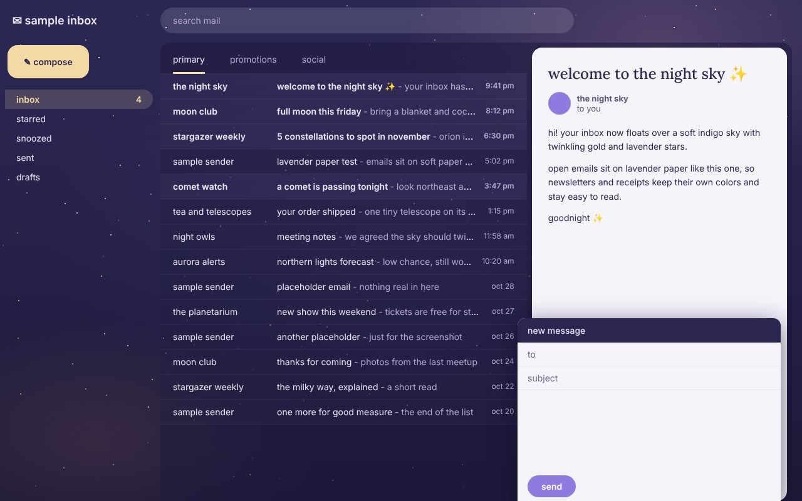

# gmail night sky

a chrome extension that puts a soft, sparkly nighttime sky behind gmail. indigo gradient, warm glows in the corners, gold and lavender stars that twinkle, and emails on soft lavender paper.



## quickstart

```bash
git clone https://github.com/arikthehacker/gmail-night-sky.git
```

no git? grab the zip from [releases](https://github.com/arikthehacker/gmail-night-sky/releases/latest) and unzip it.

1. in gmail, open settings (the gear), click **view all** next to theme, pick **dark**, and save
2. open `chrome://extensions`
3. turn on **developer mode** (top right)
4. click **load unpacked** and pick the `gmail-night-sky` folder
5. refresh gmail

expected result:

```
the inbox floats over the night sky, stars twinkle in the background
open emails and the compose window sit on lavender paper
the compose button is gold and send is purple
```

to turn it off, flip its toggle on `chrome://extensions`.

## how it works

it's two css files and no permissions. chrome injects them into `mail.google.com` only. there's no javascript, so the extension never reads your email.

| file | job |
| --- | --- |
| `stars.css` | the sky gradient and four tiled layers of stars |
| `theme.css` | makes gmail's dark theme see-through and adds the purple and gold |

**the stars are plain css.** each layer is a fixed pseudo-element with an svg tile as its background. the twinkle only animates `opacity`, so the gpu handles it and the page does no work per frame.

```css
html::after {
  background: url("data:image/svg+xml,...") 0 0 / 683px;
  animation: night-twinkle 5.3s ease-in-out 0s infinite alternate;
  will-change: opacity;
}
```

with reduced motion turned on in your os, the twinkle stops and the stars stay still.

**the theme builds on gmail's dark theme.** gmail's dark theme already handles readable text everywhere, so `theme.css` only swaps its backdrop for the sky and tints the panels.

```css
.wl {
  background: transparent !important;
}

.bkK > .nH {
  background: #1e1a3e8c !important;
}
```

**emails stay readable.** a lot of emails bring their own white backgrounds, so the reading pane and compose window become lavender paper instead of see-through glass.

```css
.ao9 {
  border-radius: 16px;
  overflow: hidden;
}
```

## changing the stars

`stars.css` is generated. edit the counts, colors or tile sizes in `make_stars.py`, then rebuild:

```bash
python3 make_stars.py
```

expected output:

```
wrote .../gmail-night-sky/stars.css (7193 bytes)
```

reload the extension on `chrome://extensions` to see the change.

made to match [github-night-sky](https://github.com/arikthehacker/github-night-sky).
